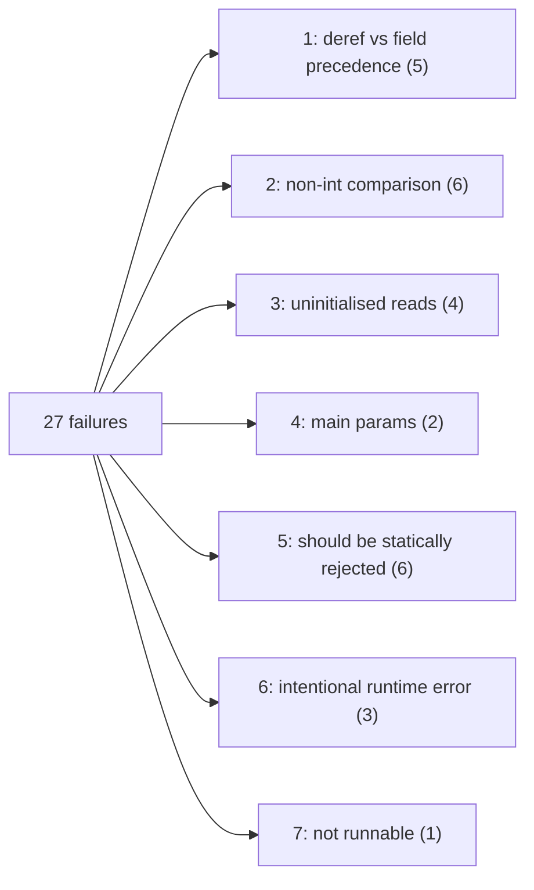

# Example test failures

Baseline: 2026-10-20, working copy after the `// CHECK-ONLY` test directive was added. Previous baselines: 50 failures (2026-10-20, after `null`/`input` evaluation), 54 failures (2026-10-15, `lwpqlokk`).

Result of `stack test`: **136 examples, 27 failures, 20 pending**. All 27 failures are in `ExamplesSpec`; `ParserSpec` is green. The 20 pending are the `// XFAIL: no main function` files.

Failures are grouped by **root cause**, not by error text. Some error messages are misleading. For example, `no Add defined on Id "a" and Id "b"` is really a read of an uninitialised variable, because [`evalBinOp`](src/TipInterpreter.hs#L136) prints the operand *AST* and not the operand *values*.

> [!NOTE]
> Line anchors in the links below refer to the source as of the baseline and will drift as the code changes.

## Summary

| # | Bucket | Kind | Count | Δ since previous baseline |
|---|--------|------|------:|---:|
| 1 | `*` binds looser than `.` field access | Parser bug | 5 | — |
| 2 | `==` / `>` only defined on integers | Interpreter gap | 6 | — |
| 3 | Reads of uninitialised variables | Program/semantics | 4 | — |
| 4 | `main` takes parameters | Interpreter gap | 2 | — |
| 5 | Meant to be rejected by static analysis | Expected error | 6 | — |
| 6 | Intentional runtime error | Expected error | 3 | — |
| 7 | Not a runnable program (parser test only) | Not runnable | 1 | — |
| | **Total** | | **27** | −23 |

The previous "missing `// INPUT:` directive" bucket (23) is gone: those files are now marked `// CHECK-ONLY`. See [Parse-only examples](#parse-only-examples) below.

---

## Parse-only examples

`// CHECK-ONLY` makes [ExamplesSpec](test/ExamplesSpec.hs#L57) stop after [`parseProgram`](src/Parser/TipParser.hs#L163-L164) succeeds, without evaluating. 26 files carry it: the 23 former bucket-1 files, plus cfa and interval2 (which only mention `input` in comments and passed before) and input1.

**Files:** block, cfa, constants1, constants2, factorial_iterative, factorial_recursive, fib, foo, func, if_short_if, input1, interval0, interval1, interval2, interval3, liveness, mono, reaching, rec, shape, slicing, symbolic1, symbolic2, testdiv, verybusy, while_short_if

These count as passes, but they only show that the program parses. The interpreter paths they exercise (`input`, recursion, loops over input) are not covered.

> [!NOTE]
> - input1 also has `// XFAIL: no main function`. `CHECK-ONLY` is matched before `failReason` is inspected, so the XFAIL has no effect: input1 moved from pending to passing, which is why pending dropped from 21 to 20.
> - func, interval2, interval3 and symbolic2 have the `// CHECK-ONLY` line twice. This is harmless, because the flags are combined with `||`.
> - To execute these files, replace `CHECK-ONLY` with `// INPUT:` values. The harness already supports this through [`mockInputs`](test/ExamplesSpec.hs#L33-L42).

## 1. Parser: unary `*` binds looser than `.` field access (5)

**Symptom:** `looked up field X in non-record value AddressOf Cell (<ioref>)`

**Cause:** [`factorP`](src/Parser/TipParser.hs#L85) applies a unary operator to a whole `factorP`, and `factorP` already includes the trailing `.field` and call suffixes. So `*n.p` parses as `*(n.p)`. The comments in the examples show that TIP means `(*n).p`. For example, record2's `r1 = *n.p; // output 5` only produces 5 under that reading.

| File | Expression | Intended reading |
|------|-----------|------------------|
| record2 | `*n.p` | `(*n).p` → 5 |
| record3 | `*(*n.q).f` | `(*((*n).q)).f` → 4 |
| record4 | `(*(n.c).a)` | `(*(n.c)).a` → 1 |
| record5 | `*n.c.b` | `((*n).c).b` → 2 |
| record6 | `*n.c.bbb` | missing field, meant to error (`// ERROR`) |

record6 will still fail after the fix, but with `no such field bbb`. That is correct behaviour, so it would then move to bucket 6.

## 2. `==` / `>` only defined on integers (6)

**Symptom:** `no Equal defined on Id "x" and Id "y"` (and similar)

**Cause:** [`evalBinOp`](src/TipInterpreter.hs#L129-L136) only matches `Integer`/`Integer`. TIP allows `==` on pointers, on functions, and against `null`.

| File | Comparison | Expected after fix |
|------|-----------|--------------------|
| interpreter_test | `x == y` (pointers), `u == v` (functions) | pass; this is an upstream interpreter test that expects `ret == 0` |
| cmpfunc | `f == g` | pass |
| err_cmpfunc2 | `f == g` (different arities) | pass at runtime; it's only a *type* error |
| err_cmpfunc3 | `f == g` (different arities) | pass at runtime; it's only a *type* error |
| a1 | `l == null` (list traversal in `map`) | pass |
| map | `l == null` (list traversal in `map`) | pass |

Pointer equality needs an identity comparison on `IORef`. `IORef` has an `Eq` instance, but `CellValue` doesn't derive it yet. Function equality needs either a name comparison or an identity token. `null` comparisons need `Null` to be equal to itself and unequal to any address.

## 3. Reads of uninitialised variables (4)

**Symptom:** various; the value read is the `Null` from [`withVars`](src/TipInterpreter.hs#L192-L193)

| File | Read | Error |
|------|------|-------|
| available | `a+b`, both never assigned | `no Add defined on Id "a" and Id "b"` |
| andersen | `a > b`, `b` never assigned | `no GreaterThan defined on Id "a" and Id "b"` |
| steensgaard1 | `if (p)`, `p` never assigned | `invalid condition Null` |
| steensgaard2 | `*c = f`, `c` not assigned yet | `no Dereference defined for Null` |

These are analysis examples (available expressions, Andersen, Steensgaard) and were never written to execute. In TIP, variables are uninitialised after `var`, so a runtime error here is arguably the correct result. `// CHECK-ONLY` would also fit them.

## 4. `main` takes parameters (2)

**Symptom:** `wrong number of arguments to function`

**Files:** cfg (`main(n)`), parametrized_main (`main(x, y)`)

**Cause:** [`evalProgram`](src/TipInterpreter.hs#L205-L213) always calls `main` with `[]`. In TIP, `main`'s parameters are read from the input stream. The input source exists, so this only needs `evalProgram` to read one value per parameter (plus `// INPUT:` lines in both files).

## 5. Meant to be rejected by static analysis (6)

The interpreter fails on these at runtime with a sensible error. The programs are invalid by design and should be caught by declaration or type analysis.

| File | Static error | Runtime error |
|------|--------------|---------------|
| err_assignfunc | assigns to function `f` | `no variable named f in scope` |
| err_funass | assigns to function `main` | `no variable named main in scope` |
| err_funass2 | `&main` | `no AddressOf defined for FunctionValue Function main` |
| err_notlocal | uses another function's local `n` | `no variable named n in scope` |
| err_notlocal2 | `*f = 10` on a function | `no Dereference defined for FunctionValue Function f` |
| err_cmpfunc | `f > g` (type error) | `no GreaterThan defined on Id "f" and Id "g"` |

Related files that are counted in other buckets: err_cmpfunc2/3 (2), record6 (1). err_unify1 passes at runtime; its error is purely a type error.

## 6. Intentional runtime error (3)

These fail at runtime, and that is the correct behaviour. The harness just can't express "expected to fail with X".

| File | What happens | Error |
|------|--------------|-------|
| error | `error 1+2;` | `error: 3` |
| nullpointer | `n = null; *q = n;` makes `p` null, then `*p = r` | `no Dereference defined for Null` |
| ptr6 | `p = q` copies the uninitialised `q`, then `x = *p` | `no Dereference defined for Null` |

ptr6 is a pointer-analysis example that was never meant to run, so it overlaps with bucket 3.

## 7. Not a runnable program (1)

**File:** parsing.tip, which contains `r=(f)(a);`. `r`, `f` and `a` are all undeclared, so it only makes sense as a parser test. It fails with `invalid variable a`. `// CHECK-ONLY` fits it exactly.

---

## Next steps

These fixes clear the most failures:

- **Support `==` on pointers, functions and `null`** in [`evalBinOp`](src/TipInterpreter.hs#L129-L136) (bucket 2, 6 failures).
- **Fix `*` / `.` precedence** in [`factorP`](src/Parser/TipParser.hs#L85) (bucket 1, 5 failures).
- **Expected-error tests:** an `// EXPECT-ERROR: <substring>` directive in [ExamplesSpec.hs](test/ExamplesSpec.hs), next to `XFAIL`, `INPUT` and `CHECK-ONLY`, would let buckets 5 and 6 (9 failures, and arguably bucket 3) become real tests that check the error.
- **Mark parsing.tip `// CHECK-ONLY`** (bucket 7, 1 failure).
- **Read `main`'s arguments from input** in [`evalProgram`](src/TipInterpreter.hs#L205-L213) (bucket 4, 2 failures).
- **Swap `CHECK-ONLY` for `// INPUT:`** on the parse-only examples, so that they actually execute.
