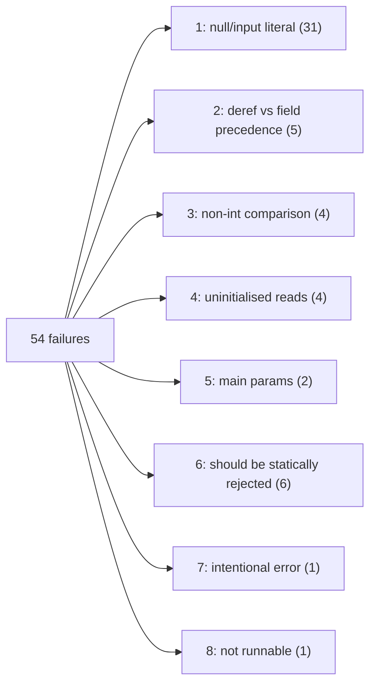

# Example test failures

Baseline: 2026-10-15, commit `lwpqlokk` "XFAIL examples without main" (on top of `orovstwr` "Add null and input literals").
Result of `stack test`: **136 examples, 54 failures, 21 pending**. All 54 failures are in `ExamplesSpec`; `ParserSpec` is green.

Failures are grouped by **root cause**, not by error text. Some error messages are misleading. For example, `no Add defined on Id "a" and Id "b"` is really a read of an uninitialised variable, because [`evalBinOp`](src/TipInterpreter.hs#L129) prints the operand *AST* and not the operand *values*.

> [!NOTE]
> Line anchors in the links below refer to the source as of the baseline commit and will drift as the code changes.

## Summary

| # | Bucket | Kind | Count |
|---|--------|------|------:|
| 1 | `null` / `input` literals not handled by the interpreter | Interpreter gap | 31 |
| 2 | `*` binds looser than `.` field access | Parser bug | 5 |
| 3 | `==` / `>` only defined on integers | Interpreter gap | 4 |
| 4 | Reads of uninitialised variables | Program/semantics | 4 |
| 5 | `main` takes parameters | Interpreter gap | 2 |
| 6 | Meant to be rejected by static analysis | Expected error | 6 |
| 7 | Intentional `error` statement | Expected error | 1 |
| 8 | Not a runnable program (parser test only) | Not runnable | 1 |
| | **Total** | | **54** |

---

## 1. `null` / `input` literals not handled by the interpreter (31)

**Symptom:** `uncaught exception: PatternMatchFail … Non-exhaustive patterns in function evalExpr`

**Cause:** `orovstwr` added `NullLiteral` and `InputLiteral` to [`Expression`](src/Parser/TipParser.hs#L32-L43), but [`evalExpr`](src/TipInterpreter.hs#L114-L170) has no cases for them. Before that commit, the same files failed with `invalid variable null` / `invalid variable input`.

| Uses | Files |
|------|-------|
| `input` only (22) | block, constants1, constants2, factorial_iterative, factorial_recursive, fib, foo, func, if_short_if, interval0, interval1, interval3, liveness, mono, reaching, rec, slicing, symbolic1, symbolic2, testdiv, verybusy, while_short_if |
| `null` only (8) | a1, a4, a6, err_unify1, map, nullpointer, ptr6, rectype |
| both (1) | shape |

> [!WARNING]
> This bucket hides other failures underneath it. Once the literals are implemented:
> - `input` needs an input source. The harness currently provides none, so these tests will block on stdin or hit EOF.
> - `nullpointer.tip` probably dereferences null on purpose.
> - `err_unify1.tip` is a type-error test (bucket 6 material).
> - More of these files may end up in buckets 3 and 4.

## 2. Parser: unary `*` binds looser than `.` field access (5)

**Symptom:** `looked up field X in non-record value AddressOf Cell (<ioref>)`

**Cause:** [`factorP`](src/Parser/TipParser.hs#L85) applies a unary operator to a whole `factorP`, and `factorP` already includes the trailing `.field` and call suffixes. So `*n.p` parses as `*(n.p)`. The comments in the examples show that TIP means `(*n).p`. For example, record2's `r1 = *n.p; // output 5` only produces 5 under that reading.

| File | Expression | Intended reading |
|------|-----------|------------------|
| record2 | `*n.p` | `(*n).p` → 5 |
| record3 | `*(*n.q).f` | `(*((*n).q)).f` → 4 |
| record4 | `(*(n.c).a)` | `(*(n.c)).a` → 1 |
| record5 | `*n.c.b` | `((*n).c).b` → 2 |
| record6 | `*n.c.bbb` | missing field, meant to error (`// ERROR`) |

This is probably what the "WIP: Add test for precedence issue" commit (`syqzrzvz`) was getting at. record6 will still fail after the fix, but with `no such field bbb`. That is correct behaviour, so it would then move to bucket 7.

## 3. `==` / `>` only defined on integers (4)

**Symptom:** `no Equal defined on Id "x" and Id "y"` (and similar)

**Cause:** [`evalBinOp`](src/TipInterpreter.hs#L122-L129) only matches `Integer`/`Integer`. TIP allows `==` on pointers and on function values.

| File | Comparison | Expected after fix |
|------|-----------|--------------------|
| interpreter_test | `x == y` (pointers), `u == v` (functions) | pass; this is an upstream interpreter test that expects `ret == 0` |
| cmpfunc | `f == g` | pass |
| err_cmpfunc2 | `f == g` (different arities) | pass at runtime; it's only a *type* error |
| err_cmpfunc3 | `f == g` (different arities) | pass at runtime; it's only a *type* error |

Pointer equality needs an identity comparison on `IORef`. `IORef` has an `Eq` instance, but `CellValue` doesn't derive it yet. Function equality needs either a name comparison or an identity token.

## 4. Reads of uninitialised variables (4)

**Symptom:** various; the value read is the `Null` from [`withVars`](src/TipInterpreter.hs#L178-L179)

| File | Read | Error |
|------|------|-------|
| available | `a+b`, both never assigned | `no Add defined on Id "a" and Id "b"` |
| andersen | `a > b`, `b` never assigned | `no GreaterThan defined on Id "a" and Id "b"` |
| steensgaard1 | `if (p)`, `p` never assigned | `invalid condition Null` |
| steensgaard2 | `*c = f`, `c` not assigned yet | `no Dereference defined for Null` |

These are analysis examples (available expressions, Andersen, Steensgaard) and were never written to execute. In TIP, variables are uninitialised after `var`, so a runtime error here is arguably the correct result.

## 5. `main` takes parameters (2)

**Symptom:** `wrong number of arguments to function`

**Files:** cfg (`main(n)`), parametrized_main (`main(x, y)`)

**Cause:** [`evalProgram`](src/TipInterpreter.hs#L199) always calls `main` with `[]`. In TIP, `main`'s parameters are read from the input stream, so this depends on the same input source that bucket 1 needs.

## 6. Meant to be rejected by static analysis (6)

The interpreter fails on these at runtime with a sensible error. The programs are invalid by design and should be caught by declaration or type analysis.

| File | Static error | Runtime error |
|------|--------------|---------------|
| err_assignfunc | assigns to function `f` | `no variable named f in scope` |
| err_funass | assigns to function `main` | `no variable named main in scope` |
| err_funass2 | `&main` | `no AddressOf defined for FunctionValue Function main` |
| err_notlocal | uses another function's local `n` | `no variable named n in scope` |
| err_notlocal2 | `*f = 10` on a function | `no Dereference defined for FunctionValue Function f` |
| err_cmpfunc | `f > g` (type error) | `no GreaterThan defined on Id "f" and Id "g"` |

Related files that are counted in other buckets: err_unify1 (1), err_cmpfunc2/3 (3), record6 (2).

## 7. Intentional `error` statement (1)

**File:** error.tip, which runs `error 1+2;` and gets `error: 3`. This is correct behaviour. The harness just can't express "expected to fail with X".

## 8. Not a runnable program (1)

**File:** parsing.tip, which contains `r=(f)(a);`. `r`, `f` and `a` are all undeclared, so it only makes sense as a parser test. It fails with `invalid variable a`.

---

## Next steps

These fixes clear the most failures:

- **Evaluate `null` / `input`** in [`evalExpr`](src/TipInterpreter.hs#L114-L170) (bucket 1, 31 failures). `input` also needs the test harness to supply input, and that same input source would fix bucket 5.
- **Fix `*` / `.` precedence** in [`factorP`](src/Parser/TipParser.hs#L85) (bucket 2, 5 failures).
- **Support `==` on pointers and functions** in [`evalBinOp`](src/TipInterpreter.hs#L122-L129) (bucket 3, 4 failures).
- **Expected-error tests:** an `// EXPECT-ERROR: <substring>` mechanism in [ExamplesSpec.hs](test/ExamplesSpec.hs) would let buckets 6 and 7 become real tests that check the error, instead of being skipped with XFAIL.
